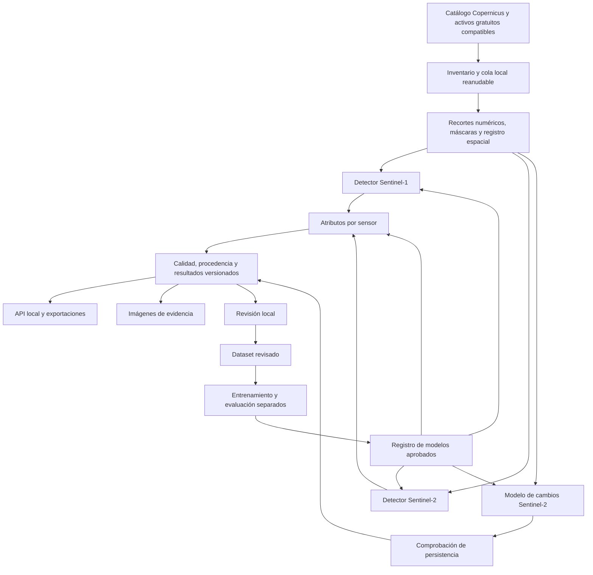

# Servicio satelital del Observatorio Portuario de Guatemala

Fecha de decisiones: 20 de octubre de 2026, Guatemala. Estado: planificación revisada y aprobada por el usuario; fase cerrada. Esta entrega contiene planificación, sin implementación ni entrenamiento.

## 1. Resultado que construiremos

Un servicio instalable que transforme imágenes gratuitas de Sentinel-1 y Sentinel-2 en observaciones portuarias propias, con datos e imágenes de evidencia. Cubrirá Puerto Quetzal, Santo Tomás de Castilla y Puerto Barrios, tanto para buques como para cambios físicos en infraestructura y patios.

La primera entrega incluirá el calendario 2025 completo y 2026 hasta la última adquisición disponible al ejecutar la carga, además del mecanismo para incorporar futuras escenas. «Completo» significa inventariar todas las adquisiciones del alcance y explicar cuáles pudieron procesarse; no significa tener una medición utilizable todos los días.

Nosotros desarrollaremos, especializaremos y validaremos los modelos. El equipo del observatorio recibirá el servicio, los pesos especializados, una copia del histórico y documentación para integrarlo. El cruce con datos oficiales o AIS será responsabilidad del observatorio. El servicio satelital funcionará sin ese cruce.

## 2. Decisiones acordadas y límites

| Tema | Decisión |
|---|---|
| Fuentes | Gratuitas y accesibles sin acuerdos institucionales. Se permite registro gratuito para acceder a Copernicus. |
| Desarrollo de ML | Partir de bases preentrenadas; construir nuestro dataset portuario y entrenar pesos especializados. |
| Buques | Detección, familias amplias y estimaciones de eslora y manga desde la primera versión, con abstención por campo. |
| Familias | Carga, tanquero, pasajeros, remolcador, pesquero y otros. Indeterminado representa falta de evidencia, no una familia adicional. |
| Error prioritario | Reducir falsos positivos, con meta inicial de precisión de detección de al menos 90%. Medir también omisiones. |
| Cambios físicos | Localizar cambios persistentes y mostrar evidencia; no clasificar su causa. |
| Persistencia | Estado de referencia en t0; cambio candidato en t1; persistente si sigue presente en t2. t1 y t2 son dos observaciones posteriores, utilizables y comparables. |
| Publicación | Automática y provisional, con calidad, evidencia y revisión posible. Provisional no equivale a etiqueta verificada. |
| Etiquetado | Lo asumimos nosotros; interfaz local sencilla para revisar propuestas y corregirlas. Sin dependencia del equipo del observatorio para etiquetar. |
| Alojamiento inicial | Computadora local del usuario; sin contratar capacidad adicional. |
| Entrega local | Servicio instalable e histórico portable; prueba por API en localhost. |
| Evolución | Instalación interna en la plataforma final; posible EC2 futuro, sin desplegar ni contratar ahora. |

Una observación satelital describe lo visible durante una adquisición. Por sí sola no establece llegada o salida exacta, tiempo de espera, productividad de grúas, toneladas, TEU, carga transportada, matrícula o identidad del buque. Las estimaciones de dimensiones no serán medidas certificadas. El cambio de color o reflectancia de un patio no prueba cambio de inventario.

## 3. Arquitectura y responsabilidades

Python, PyTorch y rslearn serán la base de ML. FastAPI expondrá resultados. SQLite guardará catálogo, cola y metadatos; el sistema de archivos guardará imágenes, datasets y pesos. Rasterio/GDAL, PyProj y Shapely cubrirán lectura y geometría. Se exportarán GeoJSON y Parquet. El entrenamiento y el procesamiento pesado correrán fuera del proceso HTTP.

La primera versión tendrá un trabajador pesado por vez. No necesita Redis, Kubernetes, servicios de pago ni una base geoespacial remota. Las consultas usarán puerto, tiempo y zona; la aplicación resolverá las operaciones geométricas necesarias.

## 4. Modelos que especializaremos

### 4.1 Detección radar

Base: detector público Sentinel-1 de Ai2 en rslearn_projects. Usa VV/VH de una escena objetivo y una histórica con dirección orbital compatible. Aplica un encoder SwinB por fecha, combina características y usa FPN con Faster R-CNN. La documentación describe contexto histórico de aproximadamente 60 días. Adoptaremos esa receta como referencia reproducible antes de modificarla. [Fuente](https://github.com/allenai/rslearn_projects/blob/master/docs/sentinel1_vessels.md).

Nuestro ajuste incorporará fondeos, canales y muelles locales, además de negativos difíciles: estructuras fijas, reflejos costeros y objetos que puedan parecer buques. La ausencia de contexto histórico compatible se registrará como limitación; no sustituiremos silenciosamente la segunda entrada por ceros.

### 4.2 Detección óptica

Base: detector multiespectral Sentinel-2 L1C de Ai2, con Swin, FPN y Faster R-CNN. El adaptador respetará las bandas, orden, normalización y correcciones del checkpoint fijado. Su entrada numérica no será el PNG de visualización. [Documentación](https://github.com/allenai/rslearn_projects/blob/master/docs/sentinel2_vessels.md), [configuración](https://github.com/allenai/rslearn_projects/blob/master/data/sentinel2_vessels/config.yaml).

El código público incluye un filtro que elimina detecciones cercanas a infraestructura marina; en la tubería óptica su distancia está fijada en 50 m. Ese comportamiento puede excluir precisamente los buques atracados que nos interesan. Lo reemplazaremos por una política por zonas, entrenamiento local y evaluación explícita junto al muelle. Desactivar el filtro por sí solo no demuestra calidad. [Código del filtro](https://github.com/allenai/rslearn_projects/blob/master/rslp/sentinel2_vessels/predict_pipeline.py).

### 4.3 Tipo, eslora y manga

Usaremos bases públicas de atributos para cada sensor: clasificación de tipo y regresión de dimensiones sobre recortes alrededor de cada detección. Las configuraciones publicadas incluyen esas tareas, por lo que no necesitamos inventar una arquitectura inicial sin referencia. [Configuración óptica](https://github.com/allenai/rslearn_projects/blob/master/data/sentinel2_vessel_attribute/config.yaml), [configuración radar](https://github.com/allenai/rslearn_projects/blob/master/data/sentinel1_vessel_attribute/config.yaml).

Reagruparemos las clases públicas a nuestra taxonomía y especializaremos las salidas. «Otros» reunirá familias conocidas fuera de las cinco principales; «indeterminado» será una abstención. Un error en tipo no debe hacer desaparecer una detección válida.

Cada dimensión tendrá valor estimado en metros, estado de calidad y error observado en ejemplos de referencia comparables. Solo publicaremos intervalos cuando podamos calibrarlos. El tamaño del recuadro de detección no equivale a la eslora o manga física. El remuestreo a píxeles más pequeños no añade detalle real.

Si no hay suficiente señal o referencia para un atributo, el campo será nulo con motivo explícito. La primera versión incluirá la función y su evaluación; no prometerá dimensiones o tipos fiables para todos los buques. Si la validación impide entregar un atributo útil, se presentará el resultado y una decisión de alcance antes de liberar la versión, sin eliminarlo silenciosamente.

### 4.4 Cambios físicos

Construiremos una red siamesa: el mismo encoder procesará una imagen anterior y una posterior, y un decodificador de segmentación aprenderá dónde hubo cambio. Propuesta inicial: encoder óptico Satlas Sentinel2_SwinT_SI_MS y decodificador tipo U-Net. Satlas proporciona encoders preentrenados; esta combinación para cambios portuarios es desarrollo nuestro, no un detector de cambios ya validado. [Bases disponibles](https://github.com/allenai/satlaspretrain_models).

La salida aprendida será cambio/no cambio, además de una máscara de área no observable. El modelo trabajará sobre infraestructura y patios, excluyendo agua, buques detectados y regiones inválidas cuando corresponda. El etiquetado incluirá ejemplos sin cambio bajo distinta iluminación, humedad o condición atmosférica para limitar falsos avisos.

Empezaremos con pares ópticos homogéneos y corregistrados. Sentinel-1 aportará evidencia complementaria; un cambio radar aislado no confirmará automáticamente una modificación física. No compararemos directamente intensidad radar con reflectancia óptica como si fueran la misma variable.

El intervalo del evento será entre la última observación válida sin cambio y la primera válida con cambio. La persistencia se comprobará en la segunda observación posterior con cambio. Si después se revierte, se conservará el historial y se marcará la reversión. «Persistente» no significa permanente.

### 4.5 Reproducibilidad y licencias

Antes de descargar pesos fijaremos commit de código, checkpoint, configuración y hash. No dependeremos de la etiqueta mutable `latest`. El paquete registrará también licencias y atribuciones: rslearn_projects declara código y pesos Apache 2.0 y anotaciones CC BY 4.0; los checkpoints SatlasPretrain tienen su propia licencia ODC-BY. No extenderemos la licencia de un componente a todo el conjunto. [rslearn_projects](https://github.com/allenai/rslearn_projects), [SatlasPretrain](https://github.com/allenai/satlaspretrain_models).

## 5. Datos, cobertura y preprocesamiento

### Inventario

Definiremos polígonos versionados por puerto y zona: muelles, fondeo, canal e infraestructura/patios. Las coordenadas puntuales existentes son referencias de búsqueda, no límites definitivos. Santo Tomás y Puerto Barrios tendrán áreas de atribución explícitas; una escena puede cubrir ambos sin duplicar físicamente sus archivos.

Consultaremos el catálogo para 2025 y 2026, con paginación, nivel de producto y huella. Deduplicaremos representaciones del mismo evento, como SAFE/COG, sin confundirlas con nuevas observaciones. El contexto radar previo a enero de 2025 se descargará únicamente como entrada auxiliar cuando sea necesario.

La investigación previa consultó septiembre de 2026 y encontró fechas de catálogo sobre puntos de los tres puertos. Eso no acredita cobertura completa, visibilidad ni desempeño. La consulta óptica previa fue L2A; habrá que inventariar L1C para el detector elegido. Evidencia local: [catálogo consultado](../../../output/estrategia_datos_operativos/evidencia/catalogos_20261021T005506Z.json).

### Adquisición

Copernicus será la referencia de catálogo y procedencia. Para imágenes, usaremos activos gratuitos cuya representación numérica sea compatible con la receta fijada: descarga o lectura parcial de activos oficiales, y Process API solo donde su salida sea adecuada. Los modelos públicos también documentan fuentes de activos en almacenamiento público; cada proveedor tendrá licencia, disponibilidad y acceso verificados antes de usarlo.

No alimentaremos el modelo radar entrenado con valores crudos usando gamma0 o dB sin demostrar equivalencia o volver a entrenar con esa representación. Tampoco sustituiremos L1C por L2A sin validación. Cada modelo tendrá su propio adaptador numérico y una prueba con una entrada conocida.

Usaremos recortes con contexto alrededor del área de interés. Las adquisiciones conservarán su fecha individual: no se harán mosaicos de varias fechas para contar buques. Las observaciones S1 y S2 de horas o días diferentes no se sumarán como si fueran una sola fotografía.

### Calidad

En óptico se medirán nubes, sombras, datos ausentes y fracción observable sobre cada zona, no solo el porcentaje de nubes de la tesela completa. El detector L1C necesitará una máscara de nubes compatible; la SCL de L2A no se asumirá parte de L1C. Para cambios se controlarán alineación y comparabilidad radiométrica. Radar registrará polarizaciones, órbita, geometría y calidad.

El piloto determinará límites operativos de visibilidad, tamaño de objeto, alineación y superficie mínima de cambio. Esas cifras serán resultados medidos del piloto y parámetros versionados. No hay evidencia actual para prometer sus valores.

### Cuotas y recursos gratuitos

La documentación consultada de Copernicus indica para usuarios generales 10,000 solicitudes y 10,000 unidades de procesamiento mensuales de Sentinel Hub. Su Batch Processing API no está incluida para esos usuarios. Tendremos nuestra propia cola local y consumo medido; no dependeremos de ese producto de procesamiento por lotes. Verificar cuotas nuevamente al implementar. [Cuotas oficiales](https://documentation.dataspace.copernicus.eu/Quotas.html).

Un recurso gratuito no implica procesamiento o almacenamiento ilimitados. El piloto medirá bytes y coste de API por recorte para extrapolar el histórico antes de descargarlo completo. Ante cuota agotada se guardará el punto de avance y se reanudará cuando haya capacidad.

## 6. Nuestro dataset y la revisión fácil

La pantalla local mostrará una escena o recorte con propuestas editables. Permitirá aceptar/descartar, añadir objetos omitidos, mover recuadros, asignar familia o indeterminado y marcar zonas dudosas. Para cambios mostrará antes/después y permitirá corregir el polígono. Habrá atajos de teclado, guardado por acción y recuperación de sesión.

Orden de trabajo:

1. Incorporar etiquetas públicas compatibles y registrar procedencia/licencia.
2. Obtener una muestra local de los tres puertos, ambas épocas del año y ambas fuentes.
3. Ejecutar las bases para proponer etiquetas y priorizar casos inciertos, errores y zonas nuevas.
4. Revisar también muestras completas escogidas independientemente del detector, para encontrar omisiones.
5. Guardar propuesta y corrección por separado, con autor, fecha y estado de revisión.
6. Congelar una versión revisada para entrenamiento y una muestra independiente para evaluación.

Las propuestas automáticas no se convierten en verdad de referencia por ser aceptadas en lote. Ningún agente o modelo se usará como único juez de su propia precisión. La revisión humana necesaria la haremos nosotros, con ayuda de la interfaz; la automatización reducirá trabajo, pero no sustituirá evidencia ausente.

Para tipo y dimensiones, una etiqueta de referencia debe provenir de un dataset documentado o una fuente pública que podamos asociar de forma suficientemente inequívoca al ejemplo. Si esa asociación no existe, no se adivinará a partir de una sugerencia del modelo. Podemos usar referencias externas gratuitas para construir etiquetas sin crear una dependencia AIS en el servicio de inferencia.

Los cambios usarán polígonos revisados sobre series, con estado no observable cuando no se pueda decidir. Un objeto temporal o una sombra no será una etiqueta de cambio físico persistente.

### Separación de datos

Agruparemos teselas solapadas y recortes relacionados antes de separar conjuntos. Cuando conozcamos identidad de buque, evitaremos que ejemplos del mismo buque generen una evaluación engañosa entre conjuntos. Las parejas temporales relacionadas permanecerán juntas.

Usaremos entrenamiento, calibración y prueba separados, con prueba temporal posterior y representación de los tres puertos. Los ejemplos de prueba local quedarán fuera de nuestro ajuste y elección de umbral. El posible solapamiento con el preentrenamiento público se documentará: no afirmaremos independencia respecto de un corpus que no podamos auditar.

El número final de etiquetas dependerá de cobertura y dificultad, no de una cifra arbitraria de buques. Crecerá por rondas hasta poder estimar los errores relevantes o demostrar que una clase no cuenta con soporte suficiente.

## 7. Entrenamiento local y evaluación

Se identificó una Mac ARM64 con 24 GiB de memoria y aproximadamente 355 GiB de espacio disponible durante la inspección. No se ha ejecutado entrenamiento ni medido el uso de estos modelos. La existencia del comando Docker no acredita que el daemon esté operativo.

Primero probaremos inferencia sobre recortes pequeños, después un paso de entrenamiento y luego una ronda corta con encoder congelado. Cargaremos un modelo por vez y cachearemos características cuando corresponda. Solo descongelaremos capas adicionales si el ensayo de memoria y tiempo lo permite.

El entrenamiento nativo podrá usar MPS cuando PyTorch y las operaciones concretas lo soporten; mantendremos una ruta CPU. El contenedor de inferencia tendrá una ruta CPU portable para ARM64 y x86_64. No trasladaremos al Mac sin verificar los ejemplos upstream que requieren `--gpus all`. [PyTorch MPS](https://docs.pytorch.org/docs/2.14/notes/mps.html), [GPU en Docker Desktop](https://docs.docker.com/desktop/features/gpu/).

Si el modelo no cabe o no resulta operativo, el primer ajuste será reducir lote, cachear y congelar encoder. Cambiar de arquitectura, contratar GPU o reducir alcance se presentará como decisión si llega a ser necesario. No se prometerá un tiempo total de procesamiento antes de medirlo.

| Tarea | Evaluación obligatoria | Criterio de entrega |
|---|---|---|
| Detección | Precisión, recall, falsos positivos por escena y número de ejemplos; desglose por puerto, sensor y zona. | Meta de precisión ≥0.90 en prueba revisada, con tamaño de muestra e intervalo de incertidumbre. No equivale a score ≥0.90. Los estratos sin evidencia suficiente se identificarán. |
| Tipo | Matriz de confusión, macro-F1, métricas por familia y porcentaje indeterminado. | Publicar solo familias con soporte y comportamiento documentados; desconocido cuando falte evidencia. La meta de detección no certifica tipo. |
| Dimensiones | Error absoluto en metros, sesgo y cobertura por sensor y rango de tamaño, contra referencias independientes. | Rango de aplicación documentado; nulo fuera de él. Comparar con una referencia simple, como la mediana del entrenamiento. |
| Cambios | Precisión por evento, recall, coincidencia de polígonos y falsos avisos en pares sin cambio. | Evidencia revisada y regla t0/t1/t2 cumplida para persistencia. Documentar límites de superficie y alineación medidos. |
| Servicio | Reanudación, deduplicación, restauración, trazabilidad y consulta del histórico. | Reinstalación y restauración probadas; una nueva adquisición no duplica resultados previos. |

El 90% se reportará como estimación observada, con su incertidumbre; una muestra pequeña no bastará para afirmar una garantía. Si un sensor o zona falla, no se ocultará dentro del promedio. Podrá conservarse para revisión como experimental, sin presentarlo como ruta validada. La política exacta de publicación quedará en el manifiesto del modelo.

## 8. Contrato de datos y API

### Entidades

| Entidad | Campos y reglas |
|---|---|
| Puerto/zona | Identificadores estables, geometría WGS84 y versión de límites. |
| Adquisición | Sensor, producto/nivel, proveedor, hora de captura UTC, publicación, huella, órbita/tesela y activos. |
| Observación | Adquisición + zona + versión de procesamiento; área observable, estado, motivos y fecha de procesamiento. |
| Detección | Geometría observada, score, familia o indeterminado, dimensiones opcionales, calidad por campo, evidencia y versión del modelo. No contiene identidad inferida. |
| Cambio | Polígono, área calculada en CRS métrico, estado, referencia, escenas de evidencia, intervalo del evento y versiones. |
| Revisión | Entidad/revisión anterior, propuesta, corrección, autor y fecha. Nunca sobrescribe silenciosamente la procedencia. |
| Modelo | Pesos/hash, código/configuración, dataset/split, métricas, taxonomía, preprocesamiento, política de publicación y licencias. |

Todas las geometrías de intercambio usarán longitud/latitud WGS84; las medidas se calcularán en CRS métrico apropiado. La fecha de captura y la fecha de procesamiento serán distintas. Los recuadros no se describirán como contornos físicos exactos.

Estados de observación: `pending`, `processing`, `usable`, `partial`, `unusable`, `failed`. El estado de revisión será independiente: `provisional`, `reviewed`, `rejected`. Cambios: `candidate`, `persistent`, `reverted`, `rejected`.

Una escena inutilizable tendrá conteo nulo, no cero. Una observación utilizable sin detecciones tendrá cero detecciones del modelo, sin afirmar ausencia absoluta de buques. En escenas parciales solo se informará lo observado dentro de la máscara válida.

### Rutas v1

| Método/ruta | Uso |
|---|---|
| `GET /health` | Estado de API y acceso a almacenamiento, sin lanzar inferencia. |
| `GET /v1/ports` | Puertos y zonas versionadas. |
| `GET /v1/observations` | Filtros `port_id`, `sensor`, `start`, `end`, `status`, con paginación estable. |
| `GET /v1/detections` | GeoJSON paginado, filtrable por observación o puerto/periodo. |
| `GET /v1/changes` | Eventos con sus escenas de evidencia y persistencia. |
| `GET /v1/coverage` | Por mes/zona/sensor: catalogadas, procesadas, utilizables, parciales y pendientes. |
| `GET /v1/assets/{asset_id}` | PNG de consulta o COG numérico registrado, con límites, CRS y atribución. |
| `GET /v1/models` | Versiones, métricas y alcance validado de cada modelo. |
| `GET /v1/jobs` | Avance, errores y reintentos. |
| `POST /v1/reviews` | Corrección interna autenticada y auditada. |

`start` será inclusivo y `end` exclusivo, en UTC. Los resultados incluirán identificadores de versión y enlaces a evidencia. La ingesta histórica, actualización y exportación se controlarán por CLI local; el API público de consulta no será una vía para lanzar trabajos costosos.

Los PNG llevarán metadatos de georreferenciación y fecha. Los COG conservarán datos numéricos y máscaras. El servicio usará identificadores de activos para servir archivos, sin aceptar rutas arbitrarias del cliente. Los resultados rechazados se excluirán por defecto, manteniendo auditoría.

## 9. Operación, almacenamiento y traslado

El servicio escuchará en localhost por defecto. La revisión usará credencial local; los secretos Copernicus quedarán fuera de Git y de la copia del histórico. La futura exposición en red requerirá configuración de autenticación y transporte del alojamiento de destino.

La cola persistirá estados y puntos de avance. Una clave de trabajo incluirá adquisición, zona y versión de receta/modelo. Los reintentos de una misma clave no duplicarán observaciones. Las salidas se escribirán primero en temporal y se publicarán al completarse. Los fallos transitorios usarán espera creciente y respetarán límites de proveedor.

Con la computadora apagada o dormida no habrá ingesta. Al reiniciar, se buscarán pendientes y publicaciones tardías; la búsqueda se solapará con el último periodo ya consultado para evitar huecos. La frecuencia de consulta se fijará con la disponibilidad y latencia medidas; no hay promesa de tiempo real continuo.

Conservaremos recortes numéricos que sostienen resultados, evidencia, correcciones, manifiestos y pesos. Los productos completos usados como transporte serán temporales. Antes de una carga se estimará espacio y se mantendrá una reserva operativa configurable; si no alcanza, se pausará sin borrar evidencia. El límite inicial del volumen se establecerá con el piloto antes del histórico masivo.

La copia portable incluirá snapshot consistente de SQLite, activos referenciados, pesos, configuración sin secretos, manifiesto de archivos y checksums. Las URLs se reconstruirán desde identificadores al restaurar. Un backup en el mismo disco facilitará restauración lógica, pero no protegerá de pérdida física del equipo.

Para EC2 o alojamiento interno se conservarán API, formatos y estructura del volumen. El primer traslado será a un host único con volumen persistente. No exige S3, base administrada ni GPU; rendimiento y coste deberán medirse si se decide esa ruta.

## 10. Etapas, entregables y decisiones de salida

1. **Piloto de viabilidad.** Inventario completo y muestra pequeña de los tres puertos; compatibilidad numérica, detección junto a muelle, un paso de entrenamiento, almacenamiento, tiempo y acceso gratuito medidos. Entrega: informe reproducible y límites operativos. No cargar todo el histórico antes de esta salida.
2. **Dataset y revisión.** Pantalla local, etiquetas públicas y locales versionadas, conjunto de prueba reservado y referencias para atributos. Entrega: dataset utilizable y protocolo de revisión.
3. **Modelos propios.** Ajuste por sensor, atributos y cambios; comparación con bases y evaluación independiente. Entrega: pesos especializados, métricas y ficha de aplicación. Solo avanzar como modelo validado donde la evidencia lo permita.
4. **Servicio integrado.** Cola, API, activos, revisión, exportaciones y restauración. Entrega: instalación local comprobada y ejemplos de consumo.
5. **Histórico y continuidad.** Procesar 2025 y 2026 hasta el corte real; informe de cobertura y excepciones; ensayo de incorporación de una nueva adquisición.
6. **Entrega al observatorio.** Servicio instalable, copia verificada, documentación, atribuciones y ensayo de restauración en un directorio limpio.

El orden es por dependencias; buques y cambios tienen la misma prioridad de producto. No hay una fecha de finalización ni precisión local demostradas. El piloto permitirá estimar esfuerzo y tiempo; cualquier necesidad de gasto o reducción material del alcance se consultará.

## 11. Qué sabemos hoy y qué falta demostrar

**Verificado:** existen catálogo accesible, bases públicas especializables y configuraciones para detección/atributos; hay muestras de catálogo sobre los tres puertos; conocemos recursos generales del equipo local.

**Diseñado:** modelos especializados, cambios por pares ópticos, revisión propia, contrato de servicio, histórico y portabilidad.

**Por demostrar mediante el piloto:** escenas L1C/GRDH utilizables para todo el alcance, etiquetas locales suficientes, compatibilidad de los pesos con el entorno, precisión ≥90%, calidad de tipos/dimensiones/cambios y coste real de procesar el histórico en el equipo disponible.

La planificación quedó cerrada por confirmación del usuario. La implementación requiere una instrucción posterior; su primera etapa será el piloto de viabilidad.
