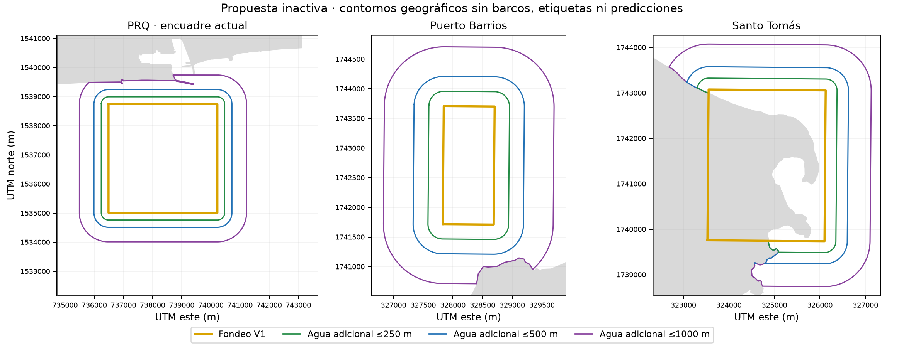

# Márgenes de búsqueda alrededor de los fondeos V1

**En PRQ caben completos los tres márgenes de 250, 500 y 1.000 m dentro del encuadre actual de 896×896 píxeles.** Son alternativas geográficas inactivas, construidas sin mirar barcos, etiquetas, detecciones o AIS. No convierten el agua adicional en fondeo oficial ni permiten decidir si un barco está fondeado.

| Puerto | Agua adicional fuera de su fondeo V1: 250 m | 500 m | 1.000 m |
|---|---:|---:|---:|
| Quetzal | 3,930 km² | 8,252 km² | 17,495 km² |
| Barrios | 1,621 km² | 3,634 km² | 8,579 km² |
| Santo Tomás | 1,918 km² | 4,103 km² | 9,398 km² |

Las alternativas están anidadas: no se suman entre sí. Parte del agua adicional ya pertenece a otra zona V1. Al restar **todas** las zonas V1, la superficie realmente nueva de PRQ sería **3,794 / 7,981 / 16,962 km²**, respectivamente; Barrios, **1,322 / 2,823 / 7,075 km²**; Santo Tomás, **1,918 / 4,103 / 9,306 km²**. Las cifras por puerto tampoco equivalen automáticamente a una unión geográfica sin solapamientos.

Para PRQ se usaron únicamente los metadatos de la entrada TRAIN del 7 de febrero de 2025, observación `096198a8-e91c-4444-b07c-1370aa4570ac`: límites EPSG:32615 `[734720, 1532160, 743680, 1541120]`, es decir **8,96×8,96 km**. El tamaño 896×896 fue proporcionado por la sesión principal; implica 10 m/píxel. Los radios equivalen a 25, 50 y 100 píxeles. El espacio limitante desde el fondeo hasta el borde del encuadre está al oeste: **1.771,4 m**. Que la geometría quepa no verifica la calidad de los píxeles, el contexto radar o la cobertura de un detector; no se abrió la imagen.

Método: en UTM 15N para PRQ y 16N para el Caribe, se calculó `(buffer(fondeo V1, radio) − fondeo V1) ∩ agua OSM`. Se reutilizó la función de clasificación de la costa congelada de `scripts/propose_geography_v2.py`; no se ejecutó su acceso opcional al catálogo. Se excluyeron tierra y áreas sin clasificación. No se añadió una franja costera de 20 m: estas cifras corresponden al límite cartografiado del agua. La opción PRQ de 1.000 m excluye **0,579 km² de tierra**; las de 250/500 m no intersectan tierra según esta fuente.

El fondeo V1 de Santo Tomás contiene **5,552 km² de tierra cartografiada de un total de 8,538 km² (65,03%)**. Los anillos no corrigen ese polígono silenciosamente. Cualquier ampliación allí necesita revisar también la ubicación del fondeo de origen; no debe presentarse como expansión de un límite operativo validado.

[proposal.json](proposal.json) contiene las nueve geometrías WGS84 inactivas, métricas, límites del encuadre y hashes de las fuentes. SHA256 del JSON: `a3bafdf405d49047eecb20abb6c942e4c32597082af2da54afed74971efdef25`. Las áreas se conciliaron y los hashes de V1, cola y costa permanecieron intactos.

La costa OSM fue recuperada el 26 de octubre de 2026 UTC; no es una reconstrucción de febrero de 2025, batimetría ni un límite de autoridad portuaria. **© OpenStreetMap contributors, [ODbL 1.0](https://www.openstreetmap.org/copyright)**. No hubo consultas nuevas de red, inferencia, adjudicación de objetos, acceso a CAL/TEST, cambios de configuración activa, catálogo o etiquetas.

Las tres alternativas quedan disponibles para un ámbito de búsqueda separado del fondeo de referencia. No se ha seleccionado ni activado un radio. Detectar un objeto en esa franja no demuestra que esté fondeado: conserva ubicación y proximidad hasta contar con evidencia de movimiento. La revisión actual mantiene su manifest; ampliar el alcance requiere otro ámbito identificable, no reinterpretar sus etiquetas.
