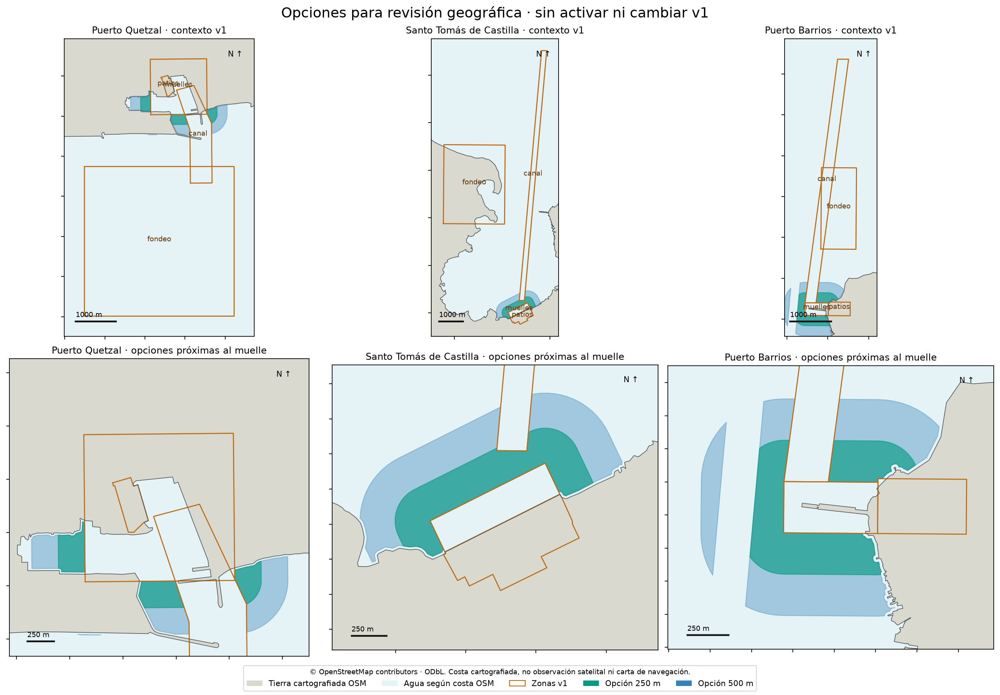

# Opciones geográficas V2 para revisión

**La opción de 250 m es un punto de partida razonable para revisar el agua próxima a los muelles.** Añade aproximadamente 1,05 km² entre los tres puertos, conecta el hueco de Santo Tomás y cabe en las teselas ya previstas por v1. La opción de 500 m amplía esa superficie a 2,41 km². Son radios analíticos prefijados, no distancias operativas confirmadas ni una elección basada en barcos observados.

Las seis geometrías de [candidates.geojson](candidates.geojson) están **inactivas**. Cada puerto tiene dos alternativas anidadas; no deben sumarse o adoptarse ambas como zonas adicionales. No se modificaron configuración, catálogo, etiquetas, particiones científicas ni plan histórico. Tampoco se descargaron nuevas escenas o ejecutó inferencia en estas áreas.



## Hallazgo independiente del detector

La costa de OpenStreetMap fija un contraste geográfico distinto de las etiquetas y predicciones del modelo. Al intersectarla con la configuración congelada, **65,03% de los 8,538 km² de `stc_fondeo` están del lado terrestre de la costa cartografiada**. El 34,97% restante está del lado marino. Esto confirma el problema ya descrito en la auditoría visual de fase 2; no mide la superficie de agua de una fecha histórica concreta.

La separación mínima de **136,867 m entre `stc_muelles` y `stc_canal`** también se reproduce sin mirar posiciones de buques. Las dos opciones cubren completamente el segmento que une esos polígonos, dentro del agua cartografiada. Las áreas nuevas no contienen tierra según esta referencia y **no heredan ni intentan corregir silenciosamente el fondeo v1**. Una corrección del fondeo necesita su propia versión y revisión.

Los recibos de cada puerto, [Quetzal](prq-baseline-audit.json), [Santo Tomás](stc-baseline-audit.json) y [Barrios](pbr-baseline-audit.json), distinguen tierra, agua y superficie sin clasificación. No se usaron imágenes, etiquetas ni predicciones de fase 3 para decidir los contornos.

## Construcción y superficie adicional

Se amplía la envolvente vigente de muelles 250 o 500 m en UTM 15N/16N. Después se conserva el lado marino de la costa OSM, se excluye una franja de 20 m junto a ella y se restan todas las zonas v1, incluidas las del otro puerto del Caribe. La franja de 20 m equivale a dos píxeles nominales del sistema y sirve como margen de revisión frente a bordes mixtos; no es una medición de error de costa ni una distancia de seguridad marítima.

| Puerto | Agua adicional, opción 250 m | Agua adicional, opción 500 m | Teselas adicionales respecto al conjunto de los tres puertos |
|---|---:|---:|---:|
| Quetzal | 0,248 km² | 0,579 km² | 0 en ambas opciones |
| Santo Tomás | 0,422 km² | 0,957 km² | 0 en ambas opciones |
| Barrios | 0,378 km² | 0,873 km² | 0 en ambas opciones |

La cuadrícula conjunta v1 tiene 12 teselas únicas. Barrios a 500 m necesitaría una tesela adicional respecto a sus dos teselas propias, pero esa tesela ya pertenece a Santo Tomás. Por eso el incremento conjunto es cero. Esto estima la reutilización de la cuadrícula, **no promete coste cero**: habrá que comprobar los archivos retenidos por adquisición, preparar las observaciones nuevas y revisar su calidad. El radio de 500 m en Barrios queda dividido por el corredor v1 de Santo Tomás; esa fragmentación aparece en el mapa y exige revisión de atribución, no una presunción de jurisdicción.

La [comprobación de huellas existentes](existing-footprint-check.json) usa las 828 adquisiciones del intervalo UTC `[2025-01-01, 2026-10-21)`. Todas las pasadas catalogadas de los tres puertos cubren geométricamente al menos 90% de cada candidata después de reunir segmentos de la misma pasada. El mínimo es 99,13% para la opción de 500 m de Barrios en radar. **Huella geométrica no equivale a píxeles despejados, contexto radar disponible ni detección correcta**; aquí no se evaluaron máscaras de calidad de las áreas propuestas.

## Referencia, límites y vigencia

Se consultaron 32 vías OSM: 14 para el Pacífico y 18 para el Caribe, 124.028 bytes en total. Los JSON originales, consultas, fecha de recuperación, versiones de cada vía y SHA256 están en [sources](sources/); el [recibo de construcción](audit.json) conserva áreas, parámetros y conteo de teselas.

La separación agua/tierra sigue la convención explícita de [OSM para `natural=coastline`](https://wiki.openstreetmap.org/wiki/Tag:natural%3Dcoastline): agua a la derecha y tierra a la izquierda de cada línea dirigida. Las líneas completas se unen con el límite del área consultada y se clasifican las caras por puntos de control a ambos lados de sus segmentos. Las caras con votos contradictorios permanecen sin clasificar; ninguna candidata invade esa categoría en este corte.

OSM es cartografía colaborativa, no un levantamiento de la autoridad portuaria. Representa una costa de referencia asociada a pleamar, puede contener desplazamientos y no describe mareas, profundidad, accesibilidad, movimientos recientes de costa o límites de operación. La fuente se recuperó el **25 de octubre de 2026, hora de Guatemala**; no se reconstruyó su estado histórico en cada captura de 2025–2026. El mapa es una representación vectorial derivada de esa fuente, no una imagen satelital.

La [investigación previa de cartas oficiales](../../local-review/phase2/caribe-official-navigation-geometry-sources.md) conserva referencias NGA independientes de posiciones de barcos, incluidas geometrías históricas de 2009/2011. Su vigencia y atribución administrativa actual no estaban confirmadas, de modo que no se adoptan aquí como límites oficiales. Esta propuesta tampoco delimita un canal navegable, dársena autorizada o fondeo oficial.

## Reproducir

Con los JSON de costa incluidos y el entorno local del proyecto (incluido Matplotlib):

```sh
PYTHONPATH=src .venv/bin/python scripts/propose_geography_v2.py
```

El script verifica los hashes originales, calcula las geometrías en metros, comprueba su topología y genera el GeoJSON, métricas y figura. Si existe `data/catalog.sqlite`, abre SQLite en modo solo lectura para conciliar las huellas del período indicado. No consulta internet al reproducir la propuesta.

La configuración v1 conserva SHA256 `8eec2e8048be87361bd5c615f18cc585e450c2938bd70ab37afac40692891589`. El GeoJSON candidato conserva SHA256 `bd37617e84a9e727472263e960d0ed59f4c9a1b9b240311de86cd4e353550f3d`.

Datos de costa y geometrías derivadas: **© OpenStreetMap contributors**, bajo [ODbL 1.0](https://www.openstreetmap.org/copyright). Esta atribución y licencia corresponden a los datos, independientemente de la licencia del código.
