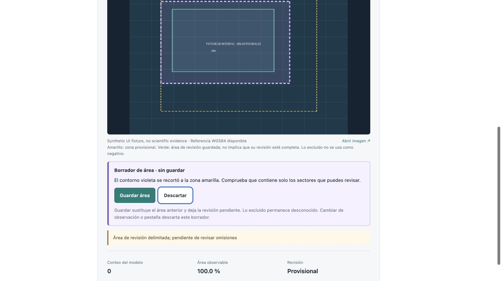

# Editor de áreas de revisión · 0.3.1

26 de octubre de 2026. El visor permite delimitar un rectángulo, previsualizar su intersección con la zona portuaria, guardar el ámbito o descartar el borrador. El guardado deja la revisión provisional y requiere completar posteriormente la búsqueda de omisiones. No se añadieron etiquetas científicas ni se entrenó un modelo.

## Verificación

- 319 pruebas con ML; 302 pruebas y 14 omisiones esperadas sin Torch. Ruff, sintaxis JavaScript y comprobación de diferencias pasan.
- 13 casos nuevos cubren autenticación, no escritura durante la previsualización, recorte, huecos, partes desconectadas, geometrías inválidas, escenas no observables, correspondencia puerto/zona, auditoría y reapertura de completitud. La validación de área ahora ocurre antes de guardar, además del control existente al exportar.
- La suite completa detectó que el importador de fase 2 no pasaba explícitamente su configuración geográfica al nuevo control. Se corrigió para utilizar la misma configuración con la que prepara el plan; las pruebas sintéticas ahora incluyen el puerto de cada zona.
- [Wheel instalada](wheel-smoke.json) en un entorno independiente: versión 0.3.1, interfaz incluida, previsualización autenticada y sin escrituras.
- Navegador sobre base sintética aislada: dibujo sin detecciones seleccionadas; recorte del rectángulo; guardar y completar; volver a delimitar y dejar pendiente; descartar sin modificar el área anterior; rechazo de área exterior y conflicto 409; cambio de observación que descarta el borrador. No se observaron errores JavaScript. Los rechazos HTTP 422 y 409 fueron provocados deliberadamente.
- [Activación local](activation.json): API 0.3.1 en el puerto 8000. El contenido lógico de adquisiciones, observaciones, detecciones, revisiones, activos y modelos fue idéntico antes y después de activar el servidor. Los 26 manifiestos protegidos y la configuración geográfica conservan sus hashes.

La captura es una prueba de interfaz con una imagen sintética, no evidencia satelital ni una etiqueta científica. El contorno violeta representa el borrador; el verde conserva el área guardada y el amarillo el límite de la zona.

## Límites y siguiente trabajo

El editor admite un rectángulo por operación y conserva la topología de la zona al recortarlo. Los huecos o uniones dibujados a medida todavía requieren la API. La previsualización no verifica nubes ni decide qué sectores son observables. La independencia de las etiquetas depende del procedimiento y de sus fuentes.

La [priorización](../../../docs/improvements.md) recomienda una cola reproducible de revisión TRAIN para ampliar ejemplos del Caribe, luego corregir geometrías y cerrar el circuito de actualización. La precisión local ≥90% continúa pendiente; esta entrega no modifica esa conclusión.
