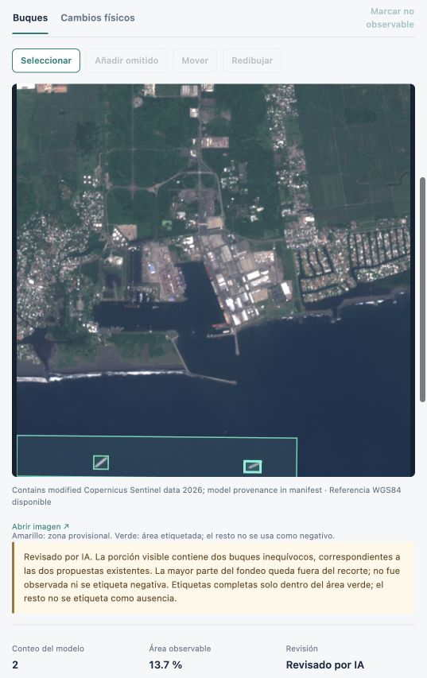

# Revisión local y primer entrenamiento

El 21 de octubre de 2026 se inspeccionaron las **22 observaciones originales en el visor** y se contrastaron con una segunda revisión visual de IA de las bandas y previews. La autoría es explícita: no son etiquetas humanas ni una validación independiente del sistema.

Se guardaron **27 revisiones auditadas**: 22 decisiones de observación y cinco cajas de buques corregidas. Las cinco cajas de zona representan cuatro observaciones de buques en dos fechas; el mismo buque óptico aparece en canal y fondeo. No se conoce su identidad entre fechas. Familia, eslora y manga permanecen nulas.

De las 22 observaciones, **19 tienen un área etiquetada explícita**. Los tres muelles en radar quedaron fuera del dataset por ambigüedad. También se excluyeron interfaces de muelle, firmas truncadas y puntos que no permitían decidir presencia o ausencia. Una región excluida no es un negativo. La revisión completa corresponde al polígono verde, no a la zona completa ni al recorte entero.

## Datos congelados y resultado

Los conjuntos de [entrenamiento y prueba](frozen-datasets.json) conservan hashes de manifiestos, referencias y bandas. Santo Tomás y Barrios pertenecen a train; Quetzal a test. Dentro de cada sensor, cada partición contiene una sola adquisición. No hay una tercera adquisición para calibración. El [protocolo previo](training-plan.md) fijó tres épocas, encoder congelado, CPU de cuatro hilos, umbrales S1=0.7/S2=0.8 e IoU=0.5.

| Sensor | Áreas train / test | Positivos train | TP / FP / FN en test, por zona | Precisión base y ajustado |
|---|---:|---:|---:|---:|
| S1 | 5 / 3 | 0 | 2 / 0 / 0 | 100% sobre dos predicciones |
| S2 | 7 / 4 | 0 | 0 / 3 / 3 | 0% a IoU=0.5 |

El ajuste solo de negativos no cambió esos conteos. En S1, el intervalo Wilson del 95% de la precisión es aproximadamente **34.2–100%**: dos aciertos no demuestran precisión ≥90% en los puertos. En S2, las cajas detectadas localizan los dos buques, pero son demasiado amplias para alcanzar el IoU fijado frente a las cajas visuales. El caso repetido entre zonas no aumenta el soporte independiente. Se conservó el resultado fallido; no se cambiaron referencias, umbral o criterio después de medirlo. Ningún modelo se seleccionó o desplegó usando este test.

La siguiente ronda utiliza adquisiciones históricas adicionales, positivos revisados y particiones temporales de entrenamiento, calibración y prueba. Los patios terrestres se evalúan como negativos; no se exige inventar barcos para llenar un estrato.

La [fase 2](phase2/protocol.md) fija selección temporal, calibración y soporte antes de evaluar. Su [runner](phase2/runner-validation-20261021-update.json) verifica las teselas originales de inferencia y bloquea mezclas entre particiones. Se congeló el [train óptico de enero](phase2/s2-january-frozen.json): 31 observaciones únicas de barcos en tres adquisiciones, 16 escenas por zona y 40 recortes. PRQ aporta 29 positivos; STC y PBR, uno cada uno. El [lote radar](phase2/s1-january-frozen.json) aporta 30 positivos de PRQ en dos pasadas, pero ninguno inequívoco de los otros puertos. Sus 42 recortes tienen una [versión corregida](phase2/crop-derivation-correction.json) que elimina un contacto de borde degenerado sin alterar las bandas ni las referencias originales.

La auditoría corrigió la [supervisión fuera del área revisada](phase2/review-supervision-correction.md): ocultar píxeles no bastaba para excluirlos de la pérdida de Faster R-CNN. La limitación afecta al ajuste de fase 1, cuyos resultados históricos se conservan. El entrenador corregido fue verificado antes de cualquier entrenamiento de fase 2.

La primera [revisión de calibración óptica](phase2/calibration-s2-round1/README.md) todavía tiene soporte insuficiente. Estos lotes no constituyen una validación del 90 %. Las auditorías [del fondeo](phase2/geometry-audit.md) y [de la cobertura del muelle](phase2/stc-quay-coverage-audit.md) documentan limitaciones de las zonas provisionales de Santo Tomás. Los polígonos activos permanecen fijados; no se desplazan para incluir un barco observado.

## Trazabilidad

- [Inspecciones del visor](viewer-inspections.json), [segunda revisión S1](s1-independent-review.json) y [segunda revisión S2](s2-independent-review.json).
- [Decisiones consolidadas](consolidated-review.json) y [recibo de las revisiones guardadas](applied-review.json).
- [Comparación reproducible de los modelos base y ajustados](results/summary.md).
- `scripts/consolidate_local_review.py` reproduce preparación, escritura auditada y congelación sobre el catálogo local correspondiente. La preparación exige evidencia de la revisión; no genera etiquetas a partir de scores.
- `scripts/train_local_pilot.py` comprueba integridad y separación y ejecuta una sola ronda por sensor con el protocolo fijado. Los modelos y datasets locales están excluidos de Git.

Estas etiquetas solo sustentan lo discernible a la resolución disponible. La ampliación de datos y el entrenamiento no convierten automáticamente una revisión de IA en evidencia humana independiente.
