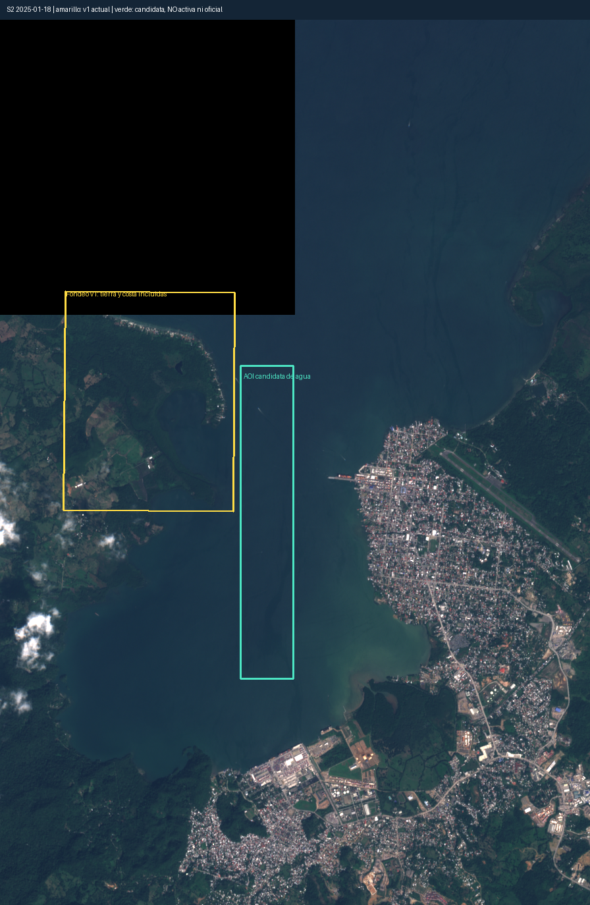

# Cobertura geográfica: fondeo de Santo Tomás

La revisión visual de la captura óptica de entrenamiento del 18 de enero de 2025 muestra que el polígono provisional `stc_fondeo` incluye principalmente una península y su costa. La lectura radar de una segunda IA confirma el problema. La descripción anterior como área de agua abierta es incorrecta. Un resultado vacío en ese polígono no demuestra ausencia de barcos en el fondeo operativo de Santo Tomás.

La [información oficial del puerto](https://santotomasport.com.gt/datospuerto/), consultada el 21 de octubre de 2026, confirma el servicio de fondeo y describe el canal de acceso, pero no proporciona los vértices del polígono usado. Esa página no valida sus límites. La evidencia directa de este hallazgo es el raster georreferenciado de la adquisición `S2B:MSIL1C:20250118T162519:R040:T16PCC`, observación `230de383-0bf2-41d4-85bd-29fd838f1ff8`.

La [candidata de área analítica](stc-fondeo-proposed-aoi.geojson) delimita 3,8 km² de agua visible al este de la península, a partir de esa imagen de entrenamiento y antes de consultar sus propuestas del detector. No se presenta como fondeadero oficial, no sirve para navegación y aún no está activa. Se verificó que no se superpone con las zonas de otros puertos. Su procedencia, coordenadas, cuadrícula y hash del raster quedan guardados.

El plan histórico y la configuración v1 se conservan para que sus resultados sigan siendo reproducibles. Las nuevas etiquetas de `stc_fondeo` restringen los negativos marinos al agua inequívocamente visible dentro de la geometría vigente; tierra, costa y áreas ambiguas quedan excluidas. Los patios se mantienen como controles terrestres explícitos, no como soporte marino.

Una precisión calculada en las áreas revisadas v1 solo describe ese alcance. No certificará cobertura del fondeo operativo ni de los tres puertos completos. Adoptar una geometría corregida requiere una versión nueva, contrastar la candidata con una referencia geográfica independiente y conservar separadas las observaciones y métricas anteriores. El hallazgo no permite desplazar el test hacia regiones donde el modelo tenga mejores resultados.
