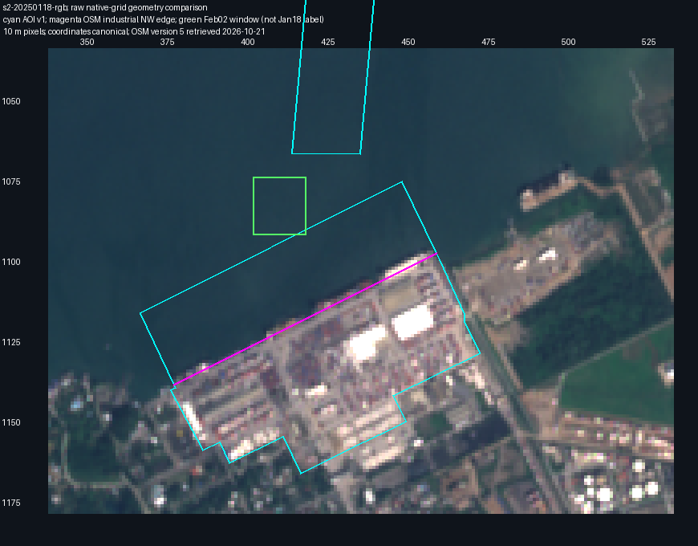
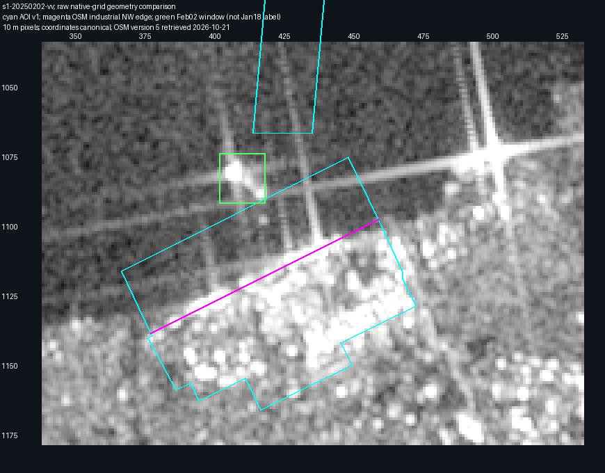

La AOI v1 de muelles sigue el borde noroeste del polígono industrial de OSM y el frente portuario visible en el RGB de entrenamiento del 18 de enero. El buque SAR del 2 de febrero está fuera de esa franja: su centro queda a **105,80 m de muelles**, a **168,74 m del canal** y a **351,64 m del borde de OSM**. No hay motivo en esta comparación para trasladar la línea del muelle.

Las ventanas de muelles y canal están separadas por **136,87 m**. La franja tiene un ancho medio de **245,84 m**, aunque la descripción actual dice aproximadamente 200 m. Esto documenta una limitación de cobertura: las áreas v1 no representan toda el agua próxima al puerto ni su posible espacio de maniobra. La evidencia no delimita un canal o dársena oficial.

La API oficial devolvió el [way 715624206, versión 5](https://api.openstreetmap.org/api/0.6/way/715624206/full.json), con fecha de edición 2025-12-08. Su segmento noroeste de 916,93 m coincide con el borde compartido de muelles y patios en la configuración. Es un polígono de uso industrial, no un levantamiento del muelle. La coincidencia con el RGB de enero es visual a resolución de 10 m; no se presenta como una medición de error de registro. Los hashes, nodos, geometrías y cifras completas están en [el informe reproducible](stc-quay-coverage-audit.json).

El rectángulo verde es la ventana visual SAR de febrero proyectada sobre ambas imágenes. **No es una etiqueta de enero.** Solo unos 137,91 m² de una esquina de esa ventana intersectan muelles; su centro está fuera de todas las zonas actuales. Se conserva como evidencia contextual y su vecindad no se utiliza como negativo.

La siguiente revisión geográfica debe fijar el alcance operativo deseado mediante referencias independientes y una versión nueva, incluida la continuidad entre las ventanas. No se propone ampliar la AOI con el recuadro de este barco. Se conservan configuración, observaciones, etiquetas y planes v1; las siguientes capturas TRAIN se siguen según el orden prefijado. No se abrieron imágenes de calibración o test.
