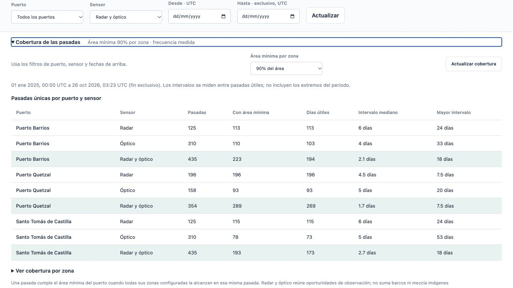

# Entrega operativa v0.3.0

El histórico quedó conciliado y el visor mide área y frecuencia por pasada. **La precisión local ≥90% sigue sin demostrarse.** La nueva versión es experimental; no habilita atributos, cambios físicos ni detecciones como resultados científicamente validados.

## Cambios y evidencia

- [Cierre global](../history/global-closure-20261026.json): 833 adquisiciones objetivo, 827 procesadas y seis excepciones de contexto radar, sin pendientes. Hay 5.018 observaciones y 4.996 pares adquisición/zona distintos. Se verificaron 122.894 archivos registrados, 31.062.920.947 bytes.
- [Pilotos completos](../history/pilot-completion-comparison-20261026.json): 24 observaciones nuevas y las 22 originales intactas. [Cinco capturas recientes](../history/incremental-20261025-closure.json): otras 32 observaciones. Las 26 particiones previamente congeladas conservan sus hashes.
- [Cobertura por pasada](../coverage/README.md): unión de máscaras compatibles sin duplicar áreas ni visitas. El visor permite exigir 50%, 90% o 100% de área por zona y consultar los intervalos realmente observados. El porcentaje de área no es precisión del detector.
- [Geografías candidatas](../coverage/geography-v2-candidates/README.md): alternativas de 250/500 m próximas a muelles, con fuentes OSM fijadas. Están inactivas; no cambian límites ni particiones científicas.
- [Desarrollo científico](../local-review/phase3-diagnosis/README.md): 32 observaciones adicionales revisadas por IA, dos ámbitos completos, una referencia nueva y 30 abstenciones. Comparación prefijada de tamaños de ancla sobre TRAIN: desarrollo interno de 80% a 85% de precisión/recall. El refit posterior obtuvo 49 TP / 1 FP / 2 FN sobre las mismas 51 referencias de entrenamiento (98% de precisión de ajuste); todavía omitió la única referencia STC. Eso no es validación independiente. CAL y TEST permanecen cerrados en esta ronda.
- Planes incrementales con selección explícita, protección de originales y control de almacenamiento más rápido, manteniendo límites y medición antes de escribir.

## Verificación

El [recibo de software](software-validation.json) registra pruebas con y sin extras ML, lint, sintaxis JavaScript y comprobación de diferencias. El primer CI de Linux detectó que una prueba de enmiendas usaba el disco real del runner; la prueba ahora fija explícitamente ese recurso, sin cambiar la reserva de producción. Ambas suites locales se repitieron tras la corrección. La [wheel instalada](wheel-smoke.json) responde desde un entorno separado a HTML, JavaScript, API y cobertura; la versión OpenAPI coincide con el paquete.

El visor se comprobó en un navegador de escritorio a 1280 × 720: filtros por puerto y fechas, periodo sin capturas, cambio del umbral y detalle por zona. La consola no reportó errores. La captura siguiente conserva la tabla actual.

[Doctor](doctor.json) conserva código de salida 2 y las cinco tareas científicas pendientes. La conciliación histórica ya está respaldada por el [recibo de evidencia operativa](release-evidence.json); no se eliminan los requisitos de validación para publicar software.

## Alcance de la publicación

Se publican código, configuración, pruebas, recibos, gráficos de revisión autorizados, wheel, fuentes y checksums. **No se incluye una copia nueva de las imágenes numéricas ni de los pesos experimentales locales.** El paquete público v0.1.0 conserva el piloto inicial. La copia local restaurada v0.2.0 conserva su corte anterior y no se presenta como copia del catálogo de v0.3.0. Esta versión no afirma una restauración nueva de los 31,06 GB ni el reinicio del histórico en otra máquina.

Las figuras de revisión contienen datos Sentinel modificados de 2025 y las capas geográficas derivan de OpenStreetMap; se conservan sus [atribuciones](../../THIRD_PARTY_NOTICES.md). No se redistribuyen materiales OSCD restringidos. La identidad de autor, committer y publicación debe ser `yehosuah`, conforme a [AGENTS.md](../../AGENTS.md).
